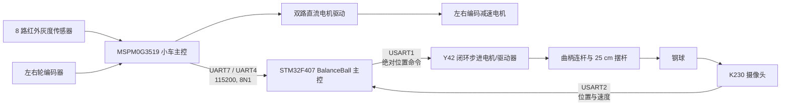

# car3519 与 BalanceBall 器件清单及模块说明

> 整理日期：2026-08-01  
> 依据工程：`E:\Elec_Competition_Code\3519\car3519`、`E:\Elec_Competition_Code\BalanceBall`  
> 判定原则：以当前 `main.c` 的初始化和调用链为准。只存在驱动文件、但未进入当前控制路径的器件单独标为“保留/可选”。

## 1. 系统组成

两个工程的职责边界如下：

- `car3519`：负责红外循迹、左右轮速度闭环、里程和时间统计、起停线判断、菜单显示，以及向 BalanceBall 下发任务号。
- `BalanceBall`：负责接收 K230 钢球位置、执行摆杆闭环，并通过串口驱动 Y42 闭环步进电机。
- 两块主控之间使用 3.3 V TTL 串口通信，TX/RX 交叉连接并共地。

## 2. 整机器件清单

### 2.1 当前主路径必需器件

| 序号 | 器件/模块 | 数量 | 所属工程 | 当前用途 | 代码可确认的规格或接口 |
|---:|---|---:|---|---|---|
| 1 | MSPM0G3519 核心板 | 1 | car3519 | 小车主控 | 80 MHz；GPIO、ADC、PWM、QEI、UART、SPI |
| 2 | STM32F407VET6 主控板 | 1 | BalanceBall | 摆杆与钢球控制 | LQFP100；STM32F4 HAL；裸机运行 |
| 3 | 8 路红外灰度传感器 | 1 | car3519 | 黑线循迹和起停线检测 | 8 路模拟量复用到单路 ADC；3 根地址线选通 |
| 4 | MC520P30_12V 编码减速电机 | 2 | car3519 | 左右轮驱动 | 1:30 减速；1024 线编码器；AB 相四倍频 |
| 5 | 双路直流电机驱动模块 | 1 | car3519 | 放大两路 PWM+DIR 电机控制信号 | 2 路方向输入和 2 路 5 kHz PWM；具体型号未在工程中记录 |
| 6 | 车轮 | 2 | car3519 | 差速行驶 | 软件参数半径 3.25 cm |
| 7 | K230 视觉模块及摄像头 | 1 | BalanceBall | 检测钢球位置和速度 | USART2，115200 8N1；发送 `位置(mm),速度(mm/s)` 文本帧 |
| 8 | Y42 闭环步进电机及串口驱动器 | 1 套 | BalanceBall | 驱动摆杆曲柄连杆 | USART1，115200 8N1；EMM V5.0 协议；闭环绝对位置模式 |
| 9 | SSD1306 128x64 OLED | 2 | 两工程各 1 | 菜单、计时、状态和调试显示 | 软件 I2C；地址 0x3C；BalanceBall 注释标为 0.69 英寸 |
| 10 | 按键 | car3519 4 个 | car3519 | 菜单上/下/确认/退出和任务启动 | 上拉输入，低电平有效 |
| 11 | 两主控串口连接线 | 3 根 | 两工程 | 任务触发通信 | TX、RX、GND；3.3 V TTL |
| 12 | 摆杆和曲柄连杆机构 | 1 套 | BalanceBall | 将电机转角转换为摆杆倾角 | 25 cm 4 分 PPR 管、铰链/合页、连杆和球铰 |
| 13 | 直径约 1 cm 钢球 | 1 | BalanceBall | 被控对象 | 赛题规定器件 |
| 14 | 车载电池及电源转换模块 | 1 套 | 整机 | 为主控、传感器和电机供电 | 电池电压、5 V/3.3 V 稳压及电机电源规格需按实物补录 |

### 2.2 当前已初始化或用于调试的器件

| 器件/模块 | 工程状态 | 说明 |
|---|---|---|
| ICM42688 六轴 IMU | car3519 当前启用 | SPI1 接口；主程序执行 `ICM_Init()`、校准并启动 5 ms 采样，可用于车体姿态诊断。|
| BLE6A20 蓝牙串口模块 | car3519 当前初始化 | UART1，115200；主要用于调试、参数观察和灰度标定，不应作为比赛运行中的遥控链路。|
| 板载 LED | car3519 当前初始化 | LED1/LED2 低电平点亮，用于运行状态提示。|
| BalanceBall OLED | 当前初始化、状态刷新关闭 | 启动和错误信息仍可显示；`TASK4_OLED_DISPLAY_ENABLE` 当前为 0。|
| BalanceBall 四个按键 | GPIO 已配置、当前主路径未调用 | 可用于本地调试菜单，但当前 Task4 由小车串口命令启动。|
| 蜂鸣器和激光输出 | GPIO 已配置、当前未使用 | 分别为 PD12 和 PD11，属于预留功能。|

### 2.3 保留驱动但非当前控制主路径

| 器件/模块 | 接口 | 当前结论 |
|---|---|---|
| QD4310 CAN 电机 | CAN1，1 Mbit/s | BalanceBall 保留驱动和 CAN 初始化，但当前摆杆控制使用 Y42 串口方案，不应同时接管执行器。使用时还需 CAN 收发器。|
| BalanceBall ICM42688 | SPI1 | 保留历史驱动，当前钢球闭环不使用。|
| 单轴 UART 陀螺仪 | USART3，115200 | 保留诊断驱动，当前主程序未启动接收；不得替代 K230 钢球位置反馈。|
| CAN2 设备 | CAN2，1 Mbit/s | CubeMX 已初始化，当前应用没有实际设备调用。|
| car3519 原摄像头接口 | UART3 | `Camera_Init()` 已注释，当前钢球视觉由 BalanceBall 侧 K230 负责。|
| car3519 原陀螺仪接口 | UART7 | 已被两主控 BalanceBall 通信复用，`Gyro_init()` 必须保持禁用。|

## 3. car3519 模块说明

### 3.1 当前启动流程

`user/src/main.c` 当前依次初始化：

1. 时钟、调试串口、LED、OLED 和按键。
2. PWM、电机、左右编码器和 8 路灰度传感器。
3. BLE6A20、两主控 UART7 通信和 BalanceBall 帧协议。
4. ICM42688、姿态校准和 5 ms 采样。
5. TIMG7 速度/里程 10 ms 采样。
6. 进入 OLED 菜单，根据任务号执行循迹或向 BalanceBall 发送启动命令。

### 3.2 软件模块

| 模块 | 文件 | 作用 | 当前状态 |
|---|---|---|---|
| PWM 输出 | `code/PWM.c`、`code/PWM.h` | 产生左右电机 5 kHz PWM | 启用 |
| 电机驱动 | `code/Motor.c`、`code/Motor.h` | PWM 调速、DIR 换向和输出限幅 | 启用 |
| 编码器 | `code/Encoder.c`、`code/Encoder.h` | TIMG8/TIMG9 正交计数 | 启用 |
| 速度与里程 | `code/getSpeed.c`、`code/getSpeed.h` | 每 10 ms 计算轮速、里程和运行时间 | 启用 |
| 灰度循迹 | `code/GrayscaleSensor.c`、`code/GrayscaleSensor.h` | 读取 8 路灰度、二值化并识别宽起停线 | 启用 |
| PID | `code/PID.c`、`code/PID.h` | 左右轮速度闭环及循迹控制运算 | 启用 |
| 任务控制 | `code/task1.c`、`code/task1.h` | 一圈循迹、速度闭环、里程门限和停车 | 启用 |
| 菜单与按键 | `code/menu.c`、`code/Key.c` | OLED 任务选择和启动 | 启用 |
| OLED | `code/oled.c`、`code/oled_i2c.c` | 显示菜单、时间、速度和状态 | 启用 |
| IMU | `code/ICM_42688.c`、`code/gyro.c` | 车体姿态采样与解算 | 启用，但非循迹必需反馈 |
| 蓝牙调试 | `code/my_ble_comm.c` | 参数和调试数据无线透传 | 初始化，主循环任务当前注释 |
| 底层串口 | `code/uart_comm.c` | UART7 字节收发 | 启用 |
| 两主控协议 | `code/balanceball_comm.c` | 帧同步、CRC16、任务命令和状态数据 | 启用 |
| 旧摄像头 | `code/camera.c` | 原摄像头串口解析 | 未启用 |

### 3.3 关键接线

| 功能 | MSPM0G3519 引脚 | 备注 |
|---|---|---|
| 电机 A PWM / DIR | PA13 / PB8 | TIMG0_CH1，5 kHz |
| 电机 B PWM / DIR | PA12 / PA8 | TIMG0_CH0，5 kHz |
| 编码器 A CH1 / CH2 | PA29 / PA30 | TIMG8 QEI |
| 编码器 B CH1 / CH2 | PB7 / PB9 | TIMG9 QEI |
| 灰度 ADC | PA27 | ADC0_CH0 |
| 灰度地址 A0/A1/A2 | PA17 / PA22 / PB10 | 选择 8 路模拟通道 |
| OLED SDA / SCL | PA0 / PA1 | 软件 I2C |
| BLE TX / RX / RTS | PB4 / PB5 / PB2 | UART1；TX/RX 按模块方向交叉连接 |
| BalanceBall TX / RX | PB15 / PB16 | UART7，115200 8N1 |
| ICM42688 SCK/MOSI/MISO/CS | PB23 / PB22 / PB21 / PB19 | SPI1 |
| K1/K2/K3/K4 | PB3 / PB12 / PB14 / PB13 | 低电平有效 |
| LED1 / LED2 | PA28 / PA31 | 低电平点亮 |

## 4. BalanceBall 模块说明

### 4.1 当前启动与控制链

`Core/Src/main.c` 当前运行 Task4 路径：

1. 初始化 STM32 GPIO、CAN1/2、SPI1、UART4、USART1/2/3 和定时器。
2. 初始化 OLED。
3. 初始化 UART4 两主控通信及 BalanceBall 协议解析。
4. 初始化 USART2 K230 接收。
5. 将已由驱动器完成配置和零点建立的 Y42 电机挂接到 USART1 控制模块。
6. 等待 car3519 发来 `START_TASK` 且 `task_id=4`。
7. 电机回到已保存绝对零点，然后使用 K230 位置与速度执行 Task4 闭环。

当前闭环为“钢球位置 P + 钢球速度阻尼”，输出摆杆目标角，再换算为 Y42 绝对脉冲位置。K230 数据无效或超时后，控制器将目标杆角回到水平。

### 4.2 软件模块

| 模块 | 文件 | 作用 | 当前状态 |
|---|---|---|---|
| K230 接收 | `Hardware/K230_uart.c` | USART2 中断收字节，解析位置和速度文本帧 | 启用，钢球反馈唯一来源 |
| Y42 协议驱动 | `Hardware/Emm_V5.c` | 发送使能、回零、速度和位置命令 | 启用 |
| Y42 摆杆控制 | `APP/ball_control_by_emm.c` | 位置误差和速度阻尼计算、角度限幅、脉冲换算 | 启用 |
| Task4 | `APP/task4.c` | 接收 K230 数据并保持固定目标位置 | 当前主任务 |
| Task3 | `APP/task3.c` | 静止状态下先到正目标、再到负目标 | 已实现但当前 `main.c` 未调用 |
| 两主控底层串口 | `Hardware/uart_comm.c` | UART4 中断收发 | 启用 |
| 两主控协议 | `Hardware/balanceball_comm.c` | 解析 car3519 的 CRC16 二进制命令 | 启用 |
| OLED | `Hardware/oled.c` | 软件 I2C 状态和错误显示 | 启用 |
| QD4310 | `Hardware/QD4310.c` | 旧 CAN 电机驱动 | 保留，非当前执行器 |
| ICM42688 | `Hardware/icm42688.c` | 旧 SPI IMU 驱动 | 保留，非当前闭环反馈 |
| UART 陀螺仪 | `Hardware/uart_gyro.c` | 单轴角速度/Yaw 诊断 | 保留，当前未启动 |
| 按键 | `Hardware/key.c` | 四向本地输入 | 驱动存在，当前主路径未调用 |

### 4.3 关键接线

| 功能 | STM32F407 引脚 | 备注 |
|---|---|---|
| 两主控 UART4 TX / RX | PA0 / PA1 | 接 car3519 PB16 / PB15；115200 8N1 |
| Y42 USART1 TX / RX | PA9 / PA10 | EMM V5.0；115200 8N1 |
| K230 USART2 TX / RX | PA2 / PA3 | 主要使用 K230 TX -> PA3；115200 8N1 |
| 单轴陀螺仪 USART3 TX / RX | PB10 / PB11 | 保留诊断接口；115200 8N1 |
| OLED SCL / SDA | PE13 / PE14 | 软件 I2C，SSD1306 地址 0x3C |
| ICM42688 SCK/MISO/MOSI/CS | PA5 / PA6 / PA7 / PA4 | 保留 SPI1 接口 |
| QD4310 CAN1 RX / TX | PA11 / PA12 | 保留 CAN1 接口，1 Mbit/s，外接 CAN 收发器 |
| CAN2 RX / TX | PB12 / PB13 | 预留，1 Mbit/s |
| KEY1/KEY2/KEY3/KEY4 | PE4 / PD0 / PE3 / PD2 | 当前按键驱动对应关系 |
| 激光 / 蜂鸣器 | PD11 / PD12 | 预留输出 |

## 5. 两主控通信模块

当前两端采用相同的二进制协议：

- 物理层：115200 baud、8N1、3.3 V TTL、共地。
- 帧头：`0xAA 0x55`。
- 版本：`0x01`。
- 校验：CRC16-CCITT-FALSE。
- car3519 使用 UART7：PB15 为 TX，PB16 为 RX。
- BalanceBall 使用 UART4：PA0 为 TX，PA1 为 RX。
- Task4 启动链路：car3519 发送 `START_TASK(0x10)`，载荷 `task_id=4`；BalanceBall 收到后启动钢球闭环。

接线关系：

| car3519 | BalanceBall | 说明 |
|---|---|---|
| PB15 / UART7_TX | PA1 / UART4_RX | 小车发送任务命令 |
| PB16 / UART7_RX | PA0 / UART4_TX | BalanceBall 返回状态 |
| GND | GND | 必须共地 |

## 6. 当前配置与赛题指标的差异

以下内容是工程现状，不是器件故障：

- `BalanceBall` 当前主程序只运行 Task4，目标位置为 `-1.0 cm`，不是赛题要求的中心 `0 cm`。
- `Task3` 头文件当前配置为先到 `+6.0 cm`、再到 `-8.0 cm`，与注释中的 `-6 cm` 以及赛题要求的 `±5 cm` 都不一致。
- Task3 已有代码，但当前 `BalanceBall main.c` 不响应 `task_id=3`。
- 当前工程只包含 K230 控制数据串口，没有发现完整的视频图传、接收端录像和回放实现；该部分仍需独立图传链路或 K230 侧应用补齐。
- 电池、电机驱动板、稳压模块、Y42 供电电压和接口电平的具体型号没有写入源码，装车前必须按实物铭牌和原理图确认。
- car3519 的 BLE 仅用于调试；比赛运行期间不得用它遥控小车。

## 7. 供电与接线注意事项

- 两块 MCU、K230、Y42 驱动器和电机驱动器必须建立可靠公共地。
- MCU UART 为 3.3 V TTL，不得直接接 RS-232 电平；若 Y42 接口不是 3.3 V TTL，必须增加匹配的电平转换或收发器。
- 直流电机和 Y42 的动力电源应与逻辑电源合理分配，并做好稳压、去耦和浪涌抑制。
- 电机驱动器的持续电流和峰值电流必须覆盖两台 MC520P30_12V 电机的实测堵转需求。
- K230 和 OLED 的供电电压应按具体模块版本确认，信号电平不得超过 MCU IO 容限。
- 若启用 QD4310，CANH/CANL 之间需要正确的总线拓扑和端接电阻，不能将 MCU CAN_TX/CAN_RX 直接接到电机总线。
